# Hako 登录与身份认证总览

本文面向使用者和接入应用的开发者，介绍 Hako 自身的登录、第三方使用 Hako 登录，以及 Hako 连接外部服务时的认证。协议字段见[服务器认证协议](server-authentication.md)，部署见[服务端 README](../apps/server/README.md)，OIDC 细节见[通用 OIDC](server-oidc.md)。

## 先区分三种关系

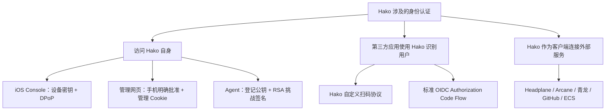

Hako 服务端目前是**单账号、多个可信管理设备**。多个 Console 对应同一账号，不是多个独立用户。没有密码登录、公开注册、短信验证码或完整多用户权限管理。用户名用于账号配置与显示；对第三方的稳定身份使用数据库持久化的 subject，不使用设备 ID 或公钥指纹替代。

| 方式 | 谁在验证谁 | 登录后获得什么 | 权限范围 |
| --- | --- | --- | --- |
| Console 设备登录 | Hako 验证已登记 iPhone 设备密钥 | Console 会话、访问/刷新凭据 | Hako 管理员，可批准登录与管理设备 |
| Hako 管理网页登录 | 手机批准本次浏览器登录 | 独立管理 Cookie + CSRF | Hako Web 管理能力 |
| Agent 认证 | Hako 验证已登记 Agent 公钥 | 已认证 WebSocket 连接 | 该设备的能力上报、请求响应；不是 Console |
| 第三方自定义扫码 | Hako 验证应用凭据，再由 Console 批准用户 | 稳定身份，可选应用授权令牌 | 该客户端自己的身份授权；不是 Hako 管理权 |
| OIDC 登录 | Hako 验证客户端与手机批准；应用验证 Hako 签名 | ID Token、OIDC Access Token | 标准用户身份及允许的资料 |
| 外部服务凭据 | 对应外部服务验证 Hako 提供的凭据 | 对应服务的 API/会话能力 | 由外部服务自己的策略决定 |

## 一、iOS Console：设备密钥登录 Hako

适用于 Hako iOS 自身的管理身份。手机本地生成 P-256 密钥，私钥保留在 Secure Enclave，仅导出公钥。操作员将公钥登记到服务端 `config/server.json` 的 `consoles`；服务启动时以配置文件为准加载信任。

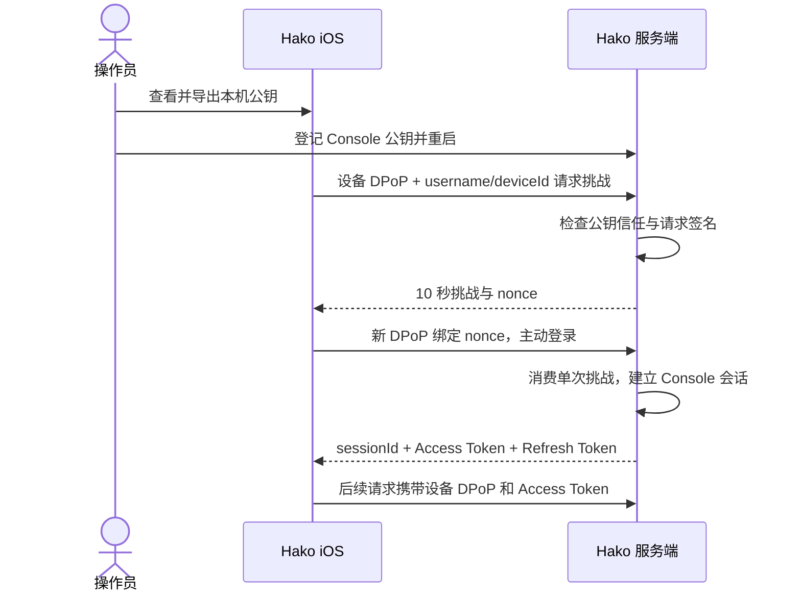

DPoP 把签名绑定请求方法、服务器 URL、时间、随机 jti；访问资源时还绑定访问令牌摘要。仅拿到访问令牌无法替代设备私钥。每个资源请求都检查会话和当前设备信任。

访问令牌 15 分钟有效；Console 刷新会话无固定或闲置时限，但可撤销。刷新使用轮换 ID 处理响应丢失，重用旧凭据的异常情况可导致会话撤销。

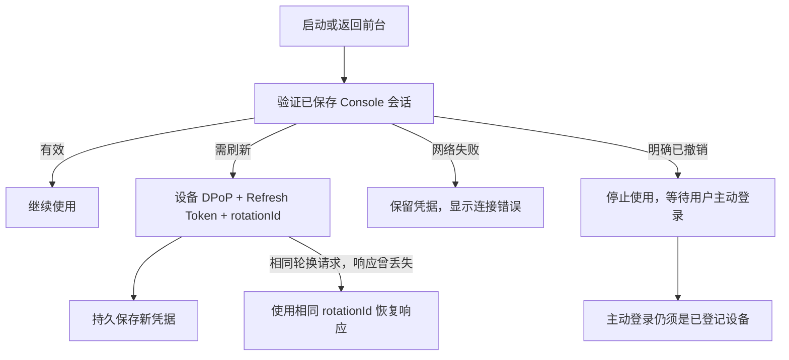

主动退出撤销当前 Console 会话，也使它批准的相关网页和应用授权不能继续使用。退出不会移除公钥信任：持有已登记私钥的设备仍可由用户主动重新登录。要禁用设备，须移除服务端公钥并重启；重置本机密钥也需要更新登记。其他 Console 不因某一台退出而失去信任。

## 二、Hako 管理网页：手机批准网页登录

适用于 `/admin/`、设备代理、访问日志及应用管理页面。管理网页本身没有密码入口，也不接收 Console 长期凭据。

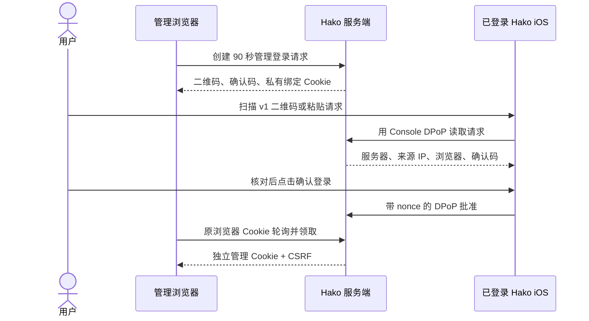

扫描、读取请求或已存在管理员登录态都不等于批准。公开请求 ID、二维码和确认码都不能替代浏览器私有 Cookie。管理页 Cookie 使用 HttpOnly、SameSite=Strict，HTTPS 下使用 Secure 和 `__Host-`；写操作还检查同源和 CSRF。

管理网页闲置 30 分钟或登录 12 小时到期；状态轮询不续期。主动退出、单独移除网页会话、批准方 Console 退出/失效，以及服务重启都会使相应网页会话失效。手机「已登录设备」可单独移除网页，不会删除 Console 公钥。

## 三、Agent：设备代理认证，不是用户登录

Agent 运行在被管理设备上。先生成 RSA 密钥，把公钥登记到 Hako；私钥留在 Agent 所在设备。当前 Agent 使用 RSA-PSS/SHA-256 挑战响应建立可信 WebSocket。

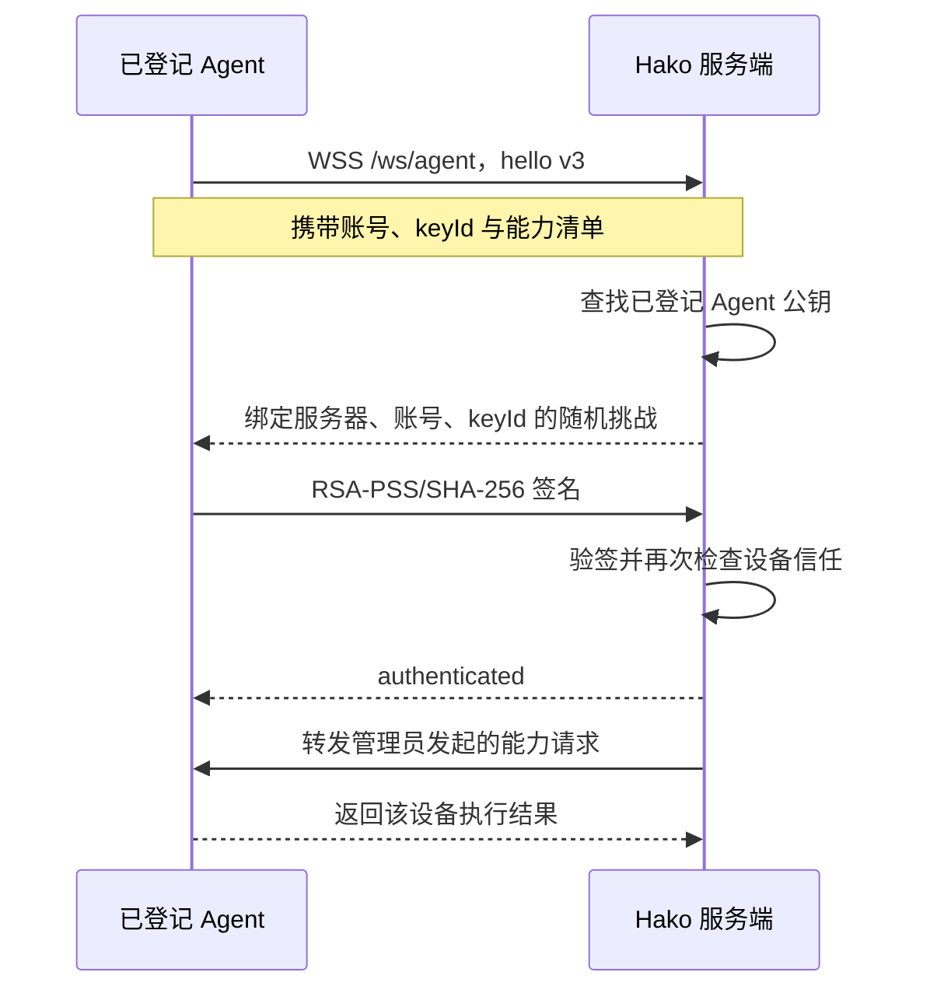

Agent 不取得 Console 会话，不能批准用户登录，也不能凭设备身份成为 Hako 管理员。移除 Agent 后立即断开现有连接并拒绝后续认证；这与退出用户网页登录是不同操作。

## 四、第三方应用接入 Hako：先登记客户端

自定义扫码和 OIDC 共用服务器上的应用登记，可从网页 `/admin/applications` 或 iOS「设置 → Hako 服务 → 第三方应用」管理。应用后端持有 Client ID 和随机 Client Secret；用户手机持有 Console 身份；两种身份不能相互替代。

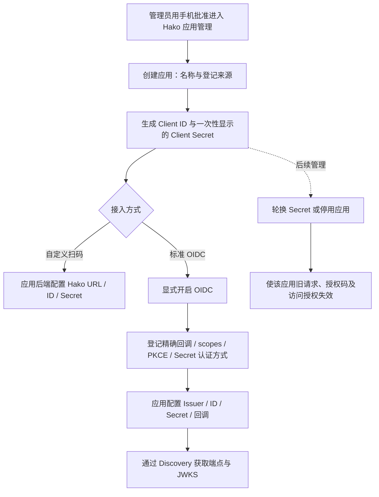

Secret 只在创建或轮换时显示；列表和日志不返回原始值，不能“找回旧 Secret”。普通扫码应用不会自动获得 OIDC 能力。一个客户端的停用、轮换或配置变更不影响其他客户端。

## 五、第三方自定义扫码：为应用绑定或登录用户

适用于能实现 Hako 专用后端协议的应用，已有接口 `/api/v1/app-login/*` 保持兼容。应用后端以 Secret 认证创建请求，持有私有 redeemToken；二维码只包含公开请求 ID 和 Hako 服务器。

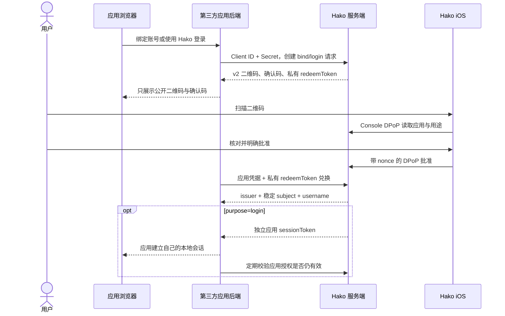

`bind` 仅返回身份，用于在应用中关联已有账号，不颁发 Hako 应用会话。`login` 额外颁发该客户端专属的 sessionToken，最长 12 小时、闲置 30 分钟；由应用加密保存在后端，不能当作管理 Cookie 或 Console Token 使用。

第三方应用按 `(issuer, subject)` 绑定用户，不能只凭用户名认人。应用需主动校验 Hako 授权并维护自己的本地登录有效性。应用自己的密码、API Key 或其他登录方式由它自行管理，不因为接入 Hako 就被替换。

## 六、标准 OIDC：让支持 OIDC 的应用使用 Hako 登录

OIDC 接口为 Discovery、Authorization、Token、UserInfo 和 JWKS。第一版实现 Authorization Code Flow、PKCE S256、`client_secret_basic` 和可配置的 `client_secret_post`。每客户端只接受登记的一种认证方式。

生产环境配置固定 HTTPS Issuer 和精确 HTTPS 回调。开发 HTTP 仅允许 HTTP loopback issuer 配合精确 loopback 回调；当前 iOS 仍要求 HTTPS。支持 `openid` 与 `profile`，不提供邮箱，也不把用户名拼成邮箱。

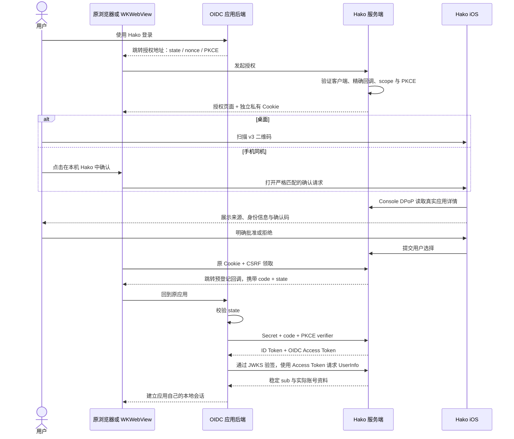

同机确认后，由**原浏览器/WKWebView**继续领取；不会仅凭公开请求 ID 在另一个浏览器领取。内置浏览器只接受来自当前配置 Hako 服务器、对应授权请求页面的用户点击，且深链必须精确匹配，不泛化放行任意 scheme。批准仍在原生确认页由用户明确操作。

授权请求 90 秒有效；批准后授权码 60 秒、单次兑换；ID Token 与 Access Token 均为 5 分钟。ID Token 使用独立、持久化的 RSA/RS256 签名密钥，客户端通过 JWKS 验证签名与 iss/sub/aud/iat/exp/nonce。Access Token 只用于 Hako UserInfo，不能调用管理接口。

没有 Implicit、密码授权、动态注册、refresh token 或完整单点注销。Headplane v0.8.2 是首个兼容验证客户端；其接入、无邮箱用户关联与 Web SSH 前置条件见[独立示例](clients/headplane-oidc.md)。这些客户端条件不进入通用 OIDC 协议。

## 七、凭据不能混用

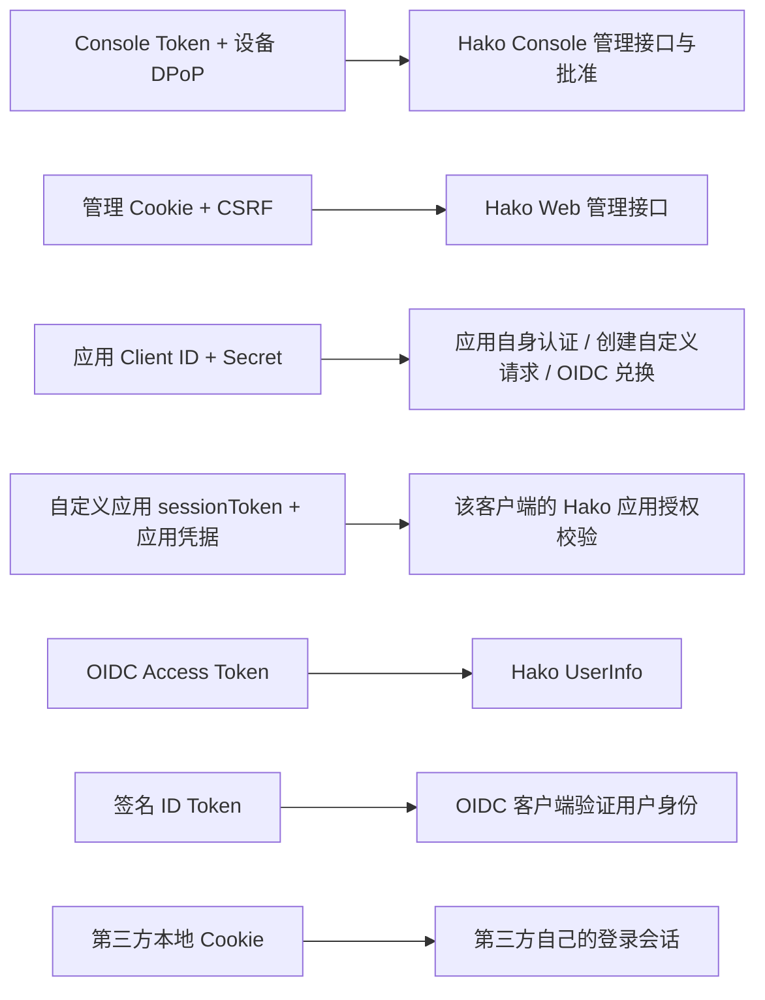

Client Secret 证明“这是登记的应用”，不能证明用户已经同意，也不赋予管理员权限。ID Token 是给相应客户端验证身份的凭证，不是 Hako 通用 API Token。Hako 管理 Cookie、自定义扫码会话和 OIDC Access Token 各有独立边界。

## 八、撤销、退出与重启

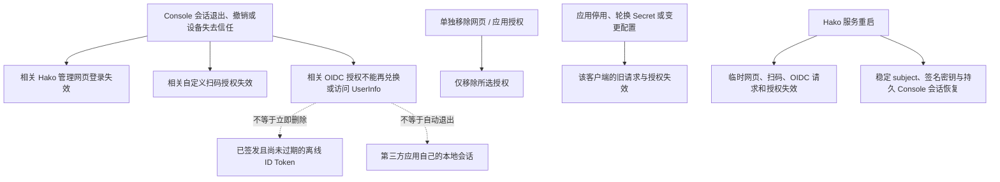

重启恢复的 Console 会话仍受当前公钥信任检查，已移除设备不会因恢复数据重新获得信任。签名密钥与 subject 应和加密数据库一起备份，masterKey 独立安全保管。只恢复部分数据、重新生成主密钥或删除数据库都可能破坏身份连续性。

手机「已登录设备」可查看 Console、管理网页登录、自定义应用授权和 OIDC 授权。当前不提供远程删除其他 Console 会话的常规入口；禁用设备应从信任配置入手。单独移除网页/应用授权不会删除设备公钥，也不会影响其他独立授权。

**Hako 授权撤销与第三方退出是两件事。** Hako 能拒绝后续兑换或授权校验，但无法远程删除第三方的 Cookie、数据库会话或已经缓存的身份结果。本版不提供完整单点注销。

## 九、Hako 连接外部服务时使用什么认证

这组功能中，Hako 是调用方；凭据由外部服务签发，不能用于登录 Hako 服务端。

| 功能 | 现有认证方式 | 与 Hako OIDC 的关系 |
| --- | --- | --- |
| 组网管理 / Headplane 原生管理功能 | 使用配置的 API Key 登录 Headplane，获得专用 Cookie；版本诊断可另外使用 info_secret | 原生 API Key 会话与 Web SSH 的 OIDC 浏览器会话隔离 |
| Headplane Web SSH | 内置浏览器中的 Headplane OIDC 登录会话 | 可选择 Hako 为 Issuer；仍要求 Headscale 用户关联、Agent、Tailscale SSH 和策略 |
| 容器管理 / Arcane | 配置 API Key，发送 `X-Api-Key` | 不自动改为 Hako OIDC |
| 青龙面板 | 配置青龙 Client ID/Secret，换取青龙访问 Token | 与 Hako 应用 Client ID/Secret 不同 |
| GitHub 数据/构建等能力 | 主应用配置 GitHub Token，以 Bearer 调用 GitHub | 权限与有效期由 GitHub Token 决定 |
| 阿里云 ECS | AccessKey ID/Secret 签名请求，可带 STS SecurityToken | 由阿里云 RAM/STS 权限约束 |

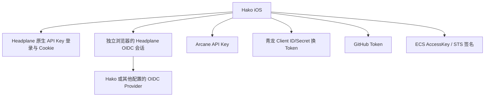

凭据由各自服务适配器管理，子应用不读取其他服务的秘密。更改 Hako Console 登录不会自动替换这些外部凭据；清除某个子应用连接也不等于在外部服务撤销其原始 API Key。

## 当前验证状态与使用建议

- 自身 Console、管理网页登录、Agent 和自定义扫码沿用已有机制，并有服务端回归覆盖。
- OIDC 已实现通用端点、客户端配置、明确手机批准、独立签名与 UserInfo，以及生命周期和隔离测试；独立 go-oidc/OAuth2 客户端及 Headplane v0.8.2 官方认证模块均已通过协议互操作测试。
- 新版 iOS 已完成本机后台编译、开发签名和 IPA 打包；本次没有在线设备安装/启动结果。
- 实体手机桌面/同机批准、真实 Headplane UI 登录、无邮箱时手动关联已有 Headscale 用户，以及 Web SSH 连接仍需真实实例验收。模拟批准、签名检查或构建成功不能替代这些结果。

新接入的通用应用优先使用 OIDC。需要沿用已有专用协议或明确区分绑定/登录用途的应用，可继续使用自定义扫码。部署与操作细节分别查阅[服务器认证协议](server-authentication.md)、[OIDC 说明](server-oidc.md)和 [Headplane 示例](clients/headplane-oidc.md)。
