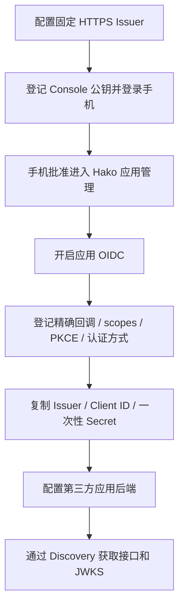
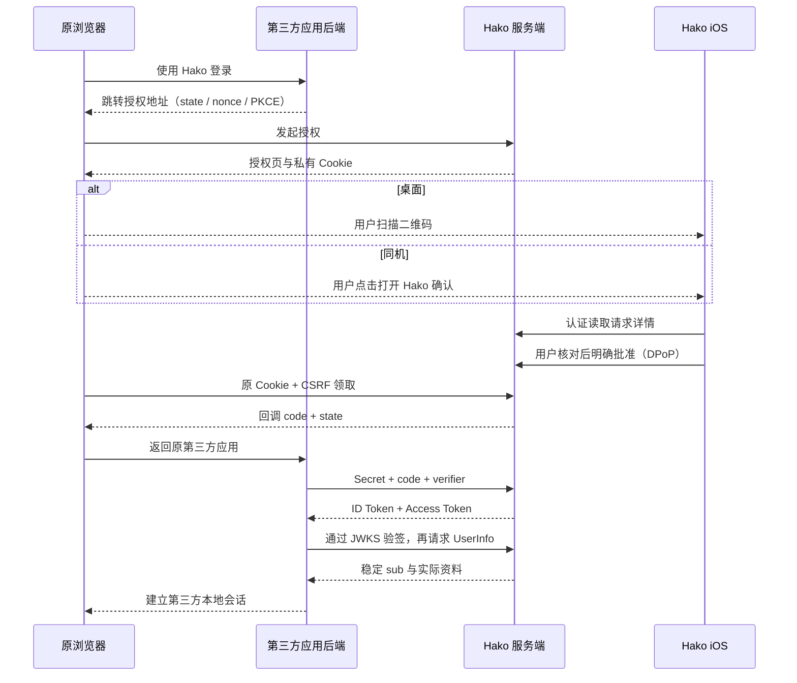

# Hako 通用 OIDC Provider

全部自身与第三方认证方式见[登录与身份认证总览](login-authentication-overview.md)。

Hako 在单账号、多个可信 Console 设备的模型上提供 OIDC。不同 Console 批准的是同一账号身份，不代表不同用户；客户端不能通过此身份取得 Hako 管理员权限。协议与 Headplane、Headscale、SSH 无关。

## 手机登录请求通知

首页设置按钮左侧提供通用「通知」入口，有消息时显示带标记的铃铛。页面按类别分组，当前仅接入真实「登录请求」：管理网页登录、第三方自定义扫码登录／绑定和 OIDC；不展示原型中的服务提醒示例。请求行简要显示来源应用、申请摘要和时间，点击后才打开原生确认 Sheet。已扫码查看但尚未批准／拒绝的请求仍可查看。Sheet 展示完整来源、操作、申请资料、浏览器及 IP；确认仍须输入原浏览器六位数字并明确点击，拒绝无需输入。管理登录明确提示管理控制台权限，第三方应用不因此获得 Hako 管理权限。

左滑「清除」仅在当前设备隐藏提醒，不批准、不拒绝，也不取消原登录请求；右上角「… → 清除全部」显示确认说明后清除当前列表。清除记录在本机持久化到请求原始到期时间，按服务器／账号隔离，刷新和重启不会恢复已清除项；仅记录通知 ID、隔离范围与期限，不保存 nonce、确认码或令牌。清除不影响其他设备或原浏览器。关闭 Sheet 不清除通知；成功处理、请求取消或到期后自动移除。通用页面、通知模型和分类位于 iOS `Hako/Notifications/`，登录确认仍由 `Hako/Server/` 处理。

前台通过 `GET /api/v1/auth/login-prompts/stream` 建立 WebSocket，使用 HTTPS 升级路径的可信 Console DPoP 和设备头认证（凭据不放入 URL，拒绝浏览器 Origin）。连接后先发送完整列表；登录请求新增、批准、拒绝、失效或应用停用时，服务端直接推送变化后的完整 JSON（与列表接口结构相同），列表未变化时不重复发送。每 15 秒 Ping/Pong 保活，每条连接最多 5 分钟并在会话撤销或 access token 到期后断开；每会话仅保留最新连接，每分钟最多建立 10 次连接，并受批准接口总限流约束。客户端不定时查询列表，断线按 3–60 秒退避重连；升级握手直接完成认证，不预先查询 `/api/v1/auth/session`，仅在 access token 距到期不足 30 秒或握手返回 401 时通过现有认证流程刷新凭据。页面恢复复用同一账号、会话 60 秒内成功的会话校验结果，凭据接近到期时不复用，后台立即断开。保留尚未到期的上次结果，过期行由本地时钟移除，不含 APNs 或离线推送。服务端和 iOS 须同时升级，代理需支持 WebSocket Upgrade。旧客户端仍可使用列表接口：`GET /api/v1/auth/login-prompts` 要求可信 Console DPoP，返回固定 issuer 和容量上限内全部待处理请求（最多 256 个），含目的、请求 ID、应用、scope、浏览器来源、期限及 nonce，**不返回确认码、浏览器绑定 Cookie 或客户端秘密**。查询不会改变请求状态。每 Console 会话每分钟最多 30 次，并受现有批准接口总限流约束。`POST /api/v1/auth/login-prompts/{id}/approve` 必须提交 `confirmationCode` 和绑定 nonce 的 DPoP；同级 `/deny` 接受空 JSON，仍要求设备认证和 nonce。旧 `/api/v1/auth/oidc/requests` 接口保持兼容，仅列出尚未扫码打开的 OIDC 请求，最多 32 个；新 iOS 不使用该接口，也不自动弹窗。

每个请求累计输错确认码五次后拒绝，多个 Console 共享计数；失效签名或错误 nonce 不计次数。查询、输入和打开 Sheet 都不等于授权。管理网页登录保留原浏览器 Cookie/CSRF，第三方扫码保留所属客户端和私有 redeemToken，OIDC 保留客户端、回调、PKCE、scope、批准设备会话和原浏览器绑定。取消、到期、处理完成及客户端配置失效后从列表移除；打开中的 Sheet 禁止继续处理失效请求。前后台及服务器／账号变化清除输入，身份变化关闭旧 Sheet；结果不确定时不自动重试。需同步更新服务端和 iOS；旧服务端不支持通知列表时提示更新，扫码方式仍可使用。

## 配置与部署

1. 配置固定 `HAKO_PUBLIC_URL=https://hako.example.com`，只允许根 origin。反向代理保持路径，提供可信 HTTPS 证书；不根据 Host 或转发头推导 issuer。
2. 按服务端 README 登记 Console 公钥，使用 iOS 登录 Console，再扫码登录 `/admin/applications`。
3. 创建应用，填写可识别名称和登记来源。勾选「启用通用 OIDC 登录」，逐行填写实际的完整回调 URL，选择 scopes、PKCE 和客户端认证方式。已有扫码应用可点击「配置 OIDC」开启。也可在 iOS「设置 → Hako 服务 → 第三方应用」通过 Console 身份登记和管理，同样须明确启用 OIDC。
4. 保存仅在创建时显示的 Client Secret；已丢失时轮换，不能读取旧值。已有应用配置 OIDC 不重新显示 Secret。列表可复制 Issuer、Client ID、回调、scope、认证方式。
5. 客户端设置 `scope=openid profile`，推荐启用 PKCE S256；若应用登记为要求 PKCE，客户端省略或使用 plain 均被拒绝。每个客户端只允许所登记的一种 Secret 认证方式。
6. 同步安装支持 v3 授权请求的 iOS。旧版手机拒绝 v3，不会在缺少 scope 提示的情况下批准。

生产环境 issuer 和回调均要求 HTTPS。开发时仅当 issuer 自身是 HTTP loopback 时，才允许登记 `http://localhost:<port>/callback`、`http://127.0.0.1:<port>/callback` 或 `http://[::1]:<port>/callback`。端口、路径、查询串均须预登记并逐字匹配，不采用原生应用的动态端口例外；不支持通配、前缀匹配、fragment、userinfo、任意重定向参数。局域网 HTTP 应用来源仍可用于原有扫码协议，但不能据此使用 HTTP OIDC 回调。iOS 当前仍要求 HTTPS，HTTP loopback 仅供协议开发测试。

创建/更新接口继续使用管理 Cookie、CSRF 与同源校验：

```json
{
  "name": "Example application",
  "origin": "https://app.example.com",
  "oidc": {
    "enabled": true,
    "redirectURIs": ["https://app.example.com/auth/callback"],
    "scopes": ["openid", "profile"],
    "requirePKCE": true,
    "authMethod": "client_secret_basic"
  }
}
```

正文用于 `POST /admin/api/applications`。更新用 `PATCH /admin/api/applications/{id}`，正文可为 `{"oidc":{...完整配置...}}` 或 `{"enabled":false}`。关闭 OIDC 用完整配置中的 `enabled:false`；不影响同一应用的自定义扫码接口启用状态。`POST /admin/api/applications/{id}/rotate` 正文 `{}` 返回新 Secret。每次更新、停用或轮换使该客户端原有请求、授权码和访问授权失效；重新开启不能恢复。其他客户端保持隔离。

## 配置与登录流程图





## 接口与实际支持范围

| 接口 | 行为 |
| --- | --- |
| `GET /.well-known/openid-configuration` | Discovery，issuer 固定为 PublicURL |
| `GET /oidc/authorize` | Authorization Code Flow，先验证客户端和精确回调 |
| `POST /oidc/token` | 表单正文，授权码兑换；Basic 或 Post 认证按登记配置 |
| `GET /oidc/jwks` | RS256 公钥、稳定 kid，不包含私钥 |
| `GET/POST /oidc/userinfo` | 仅接受 `Authorization: Bearer <OIDC access_token>` |

示例授权参数：

```text
response_type=code
client_id=<Client ID>
redirect_uri=https://app.example.com/auth/callback
scope=openid profile
state=<客户端生成并在回调验证的随机值>
nonce=<客户端生成并在 ID Token 验证的随机值>
code_challenge=<base64url(SHA256(code_verifier))>
code_challenge_method=S256
```

Token 请求为 `application/x-www-form-urlencoded`，正文包含 `grant_type=authorization_code`、`code`、与授权请求相同的 `redirect_uri`，使用 PKCE 时携带原始 `code_verifier`。Basic 方式按 OAuth2 规范对 ID/Secret 作表单编码后组成 Basic 凭据；Post 方式将 `client_id,client_secret` 放在正文，不能同时使用两种方式。客户端必须校验 state、签名、kid、iss、aud、有效期、sub，以及发起请求时的 nonce。

当前只支持 `openid`、`profile`，scope 按客户端允许列表进一步限制。`profile` 的 `name` 和 `preferred_username` 均为实际配置的账号名称，不虚构个人姓名或邮箱，不返回 `email` / `email_verified`。`sub` 复用加密数据库中的持久账号 subject；更改用户名或 Console 公钥不会改变。多个客户端收到同一 public subject，客户端应以 `(issuer, sub)` 为身份键。

支持默认/query response mode，以及省略 prompt、`prompt=consent`、`prompt=login`（每次均要求手机明确确认）。`prompt=none` 返回 `interaction_required`，其他 prompt 或组合返回错误。不支持的 scope、response_type、grant_type、response_mode 明确报错。严格拒绝重复参数、畸形编码、超长输入、未实现参数，包括 `claims`、`max_age`、`request`、`request_uri`、`login_hint`、`acr_values` 和 locales；客户端应删除这些参数。未验证客户端和回调前，错误只在 Hako 返回，不向请求提供的地址跳转。UserInfo 不接受 URL 中的凭据或查询参数。

没有 Implicit、密码授权、公开注册、动态客户端注册、refresh token、token introspection、RP/front/back-channel logout。Discovery 不发布未实现能力；本实现未取得完整 OpenID 认证。

## 授权与会话边界

浏览器首次跳转后，由 Hako 设置独立 HttpOnly、SameSite=Lax Cookie，HTTPS 下使用 Secure 和 `__Host-`。绑定值不进入二维码、深链或公开 URL。新请求会替换同浏览器上一个未完成的 OIDC 流程。

授权页展示登记应用名称、来源、申请身份信息、确认码，加载的脚本、样式和二维码均来自 Hako；CSP 禁止嵌入和第三方资源；表单仅允许 Hako 与当前预登记回调来源，兼容浏览器对表单重定向的限制。授权入口和回调响应使用 no-referrer；授权页使用 same-origin，仅同源请求可携带清理后的请求路径，向第三方不发送 Referrer，同时保留浏览器表单的 Origin 校验。桌面显示二维码；手机可点击「在本机 Hako 中确认」。iOS 严格验证 scheme、主机、版本、请求结构和当前 HTTPS 服务器，向服务器读取真实详情后由用户批准或拒绝。内置浏览器还校验来源页面恰为该请求的 Hako 授权页。

扫码、读取请求、已有管理 Cookie 均不能批准。批准使用现有 Console 会话及带 nonce 的 DPoP。浏览器轮询批准状态后，以 Cookie 和 CSRF 提交完成请求，接收带 state 的标准回调；无脚本时可点击继续。手机确认后保留原网页/原 WKWebView，不在 Hako 中另外创建回调浏览器；浏览器 Cookie 才能领取结果。手机不会持有 OIDC 客户端 Secret、授权码或 Token。

| 状态/凭据 | 有效期与撤销 |
| --- | --- |
| 待批准请求 | 90 秒，拒绝/取消/到期后不能兑换；关闭浏览器不视为批准，至到期自动失效 |
| 授权码 | 完成批准后 60 秒，单次兑换；绑定客户端、回调、scope、nonce、PKCE、批准方会话 |
| OIDC Access Token | 独立随机不透明令牌，5 分钟，仅用于 Hako UserInfo；绑定客户端、scope、批准方及授权管理 ID |
| ID Token | 独立 RSA/RS256 签名，5 分钟，包含 iss/sub/aud/iat/exp 和请求的 nonce |
| 第三方本地登录 | 由第三方客户端自行决定；Hako 不控制其 Cookie、缓存或数据库 |

Console「已登录设备」可查看并移除 OIDC 待兑换授权及访问授权，复用 `DELETE /api/v1/web-sessions/{id}`。Console 会话退出、撤销、主动重新登录替换、设备失去信任，或客户端停用、轮换、修改配置，阻止继续兑换及使用 UserInfo。第三方扫码凭据、Console Token 和管理 Cookie 不能替代 OIDC Access Token，反向也不可。不同授权和客户端具有不同的管理 ID。

**撤销不会使已签发的离线 ID Token 在密码学上失效，也不会立即清除第三方本地会话。** 第三方可通过重新登录或使用有效访问令牌访问 UserInfo 检查当前授权；需即时响应撤销的应用不能只信任自己长期 Cookie。普通第三方退出只清除该应用本地会话，不是完整 OIDC 单点注销。

请求、码和访问授权只保留在内存，重启全部失效。批准方信任仍由现有持久会话和配置决定；不会在重启后恢复过时的批准。锁顺序沿用 `adminMu -> store.mu`，兑换、单独撤销与应用失效在同一授权锁内串行执行，并校验应用配置版本，防止并发更新恢复旧授权。

## 密钥、备份与容量

首次启动使用系统加密随机源独立生成 RSA-2048 签名私钥，PKCS#8 编码，随已有 AES-GCM 加密 SQLite 状态持久化。masterKey 仅加密存储，不直接签发 ID Token；不使用 Console 私钥。kid 为公钥派生的稳定标识，JWKS 只发布公钥，重启保持不变。生成、加载或持久化失败时启动失败，不临时换钥继续运行。

停止服务后备份完整数据目录及独立保管的 `config/server.json` / masterKey；一致恢复数据库才能同时恢复账号 subject、客户端和签名密钥。保护文件访问权限，不复制真实配置到仓库。不要删除数据库或修改签名字段来执行日常轮换：当前无在线签名密钥轮换 API；后续应实现新旧 JWKS 重叠发布并保留旧验证键超过 ID Token 最大寿命及缓存窗口，再切换 signer。密钥泄露属于单独恢复操作，需同时处理第三方验证缓存和本地会话。

最多 64 个应用，每应用 16 个精确回调、2 个已实现 scope。待授权请求与原扫码共享 256 个容量，OIDC 授权码最多 256 个，访问授权最多 512 个；操作时清除过期项。授权入口按来源 IP 限制 20 次/分钟及全局 120 次/分钟；兑换 120 次/分钟、UserInfo 240 次/分钟、轮询每请求 60 次/分钟；共享限流桶有容量上限。查询参数最多 8 KiB、单值最多 2 KiB，HTTP 正文沿用 16 KiB 限制。

应用不记录码、Token、Secret、Cookie 或私钥。部署时同样配置反向代理、客户端日志与追踪脱敏，尤其禁止记录 token 表单/Authorization/Cookie，以及客户端回调中的 code。生产实例应保持时钟同步。

## 验证与尚未完成的验收

`go test ./...` 包含独立 `github.com/coreos/go-oidc/v3/oidc` 与 OAuth2 客户端的 Discovery、真实 TLS 兑换、JWKS 签名/声明和 UserInfo 验证，并覆盖参数、scope、浏览器绑定、nonce/state/PKCE、授权码重放/过期、拒绝、撤销、应用变更、并发兑换/轮换、稳定身份及密钥重启恢复。既有 Console、管理与自定义扫码测试继续运行。

Headplane 官方模块兼容测试可选，准备和运行方式见[独立接入说明](clients/headplane-oidc.md)。手机测试验证 v1/v2 兼容、v3 scope、请求替换及严格来源限制。自动化使用测试 Console 签名模拟明确批准，不能代替真人确认或真实客户端实例登录。

未完成的真实实例验收：生产域名部署、实体 iPhone 同机/跨机授权、Headplane 完整 UI 登录及本地会话、无邮箱时手动关联已有 Headscale 用户，以及具备 Agent、Tailscale SSH 与策略后的 Web SSH 连接。签名/打包成功也不代表这些场景完成。


可选真实浏览器检查（Windows PowerShell，从仓库根目录，复用测试运行依赖目录）：

```powershell
npm install --prefix build/oidc-validation/headplane-runtime --ignore-scripts --no-audit --no-fund playwright-core@1.58.2
$env:HAKO_CHROME = 'C:\Program Files\Google\Chrome\Application\chrome.exe'
$env:HAKO_PLAYWRIGHT = "$PWD/build/oidc-validation/headplane-runtime/node_modules/playwright-core/index.mjs"
Set-Location apps/server
go test ./internal/server -run TestOIDCHeadlessBrowser -v
```

该检查启动独立无头 Chrome 上下文，测试实际 Cookie、页面脚本、模拟 Console 批准、CSRF 表单及跨域回调，已实际通过。只对自签名 TLS 测试实例忽略浏览器证书错误，不改变生产 TLS 策略；不使用现有登录标签页或真实应用 Secret。没有对应环境变量时明确跳过。它仍不代替实体手机或第三方完整 UI 实例验收。
